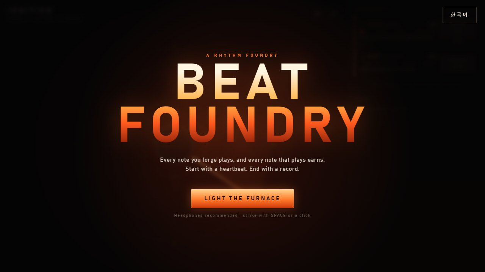
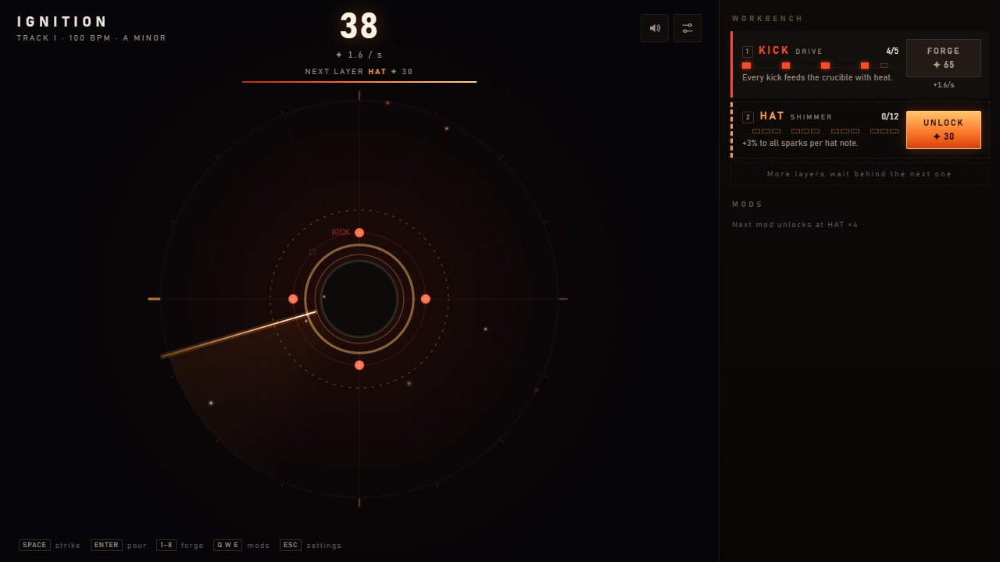
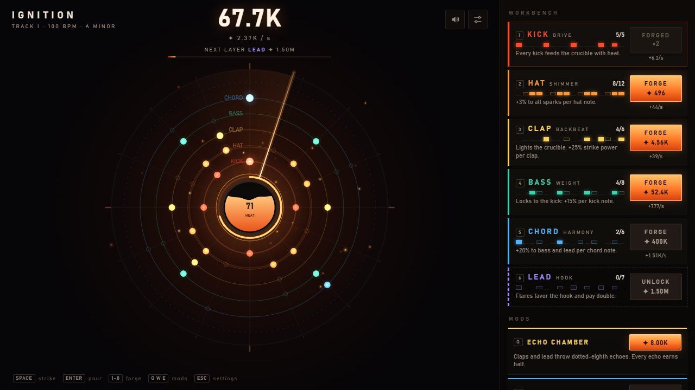
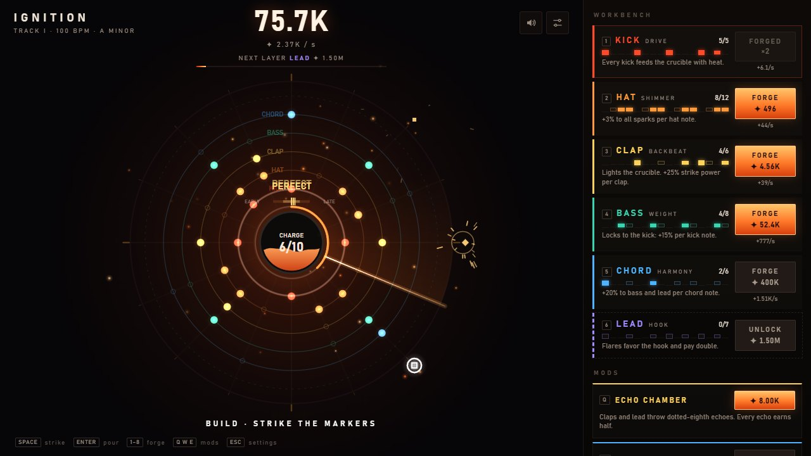
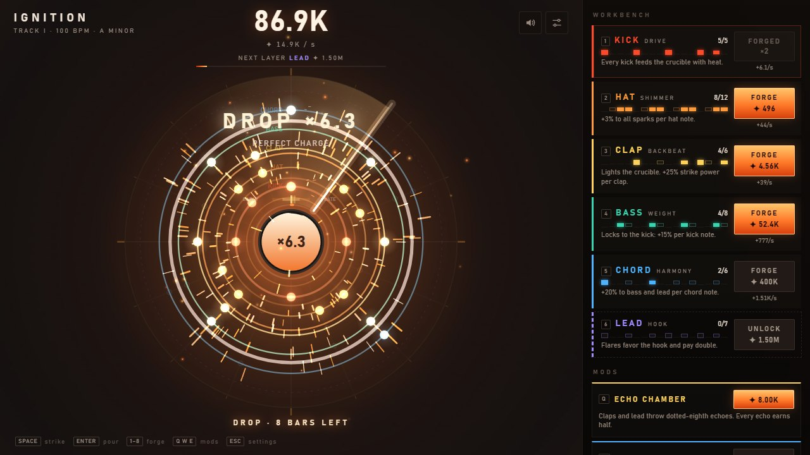
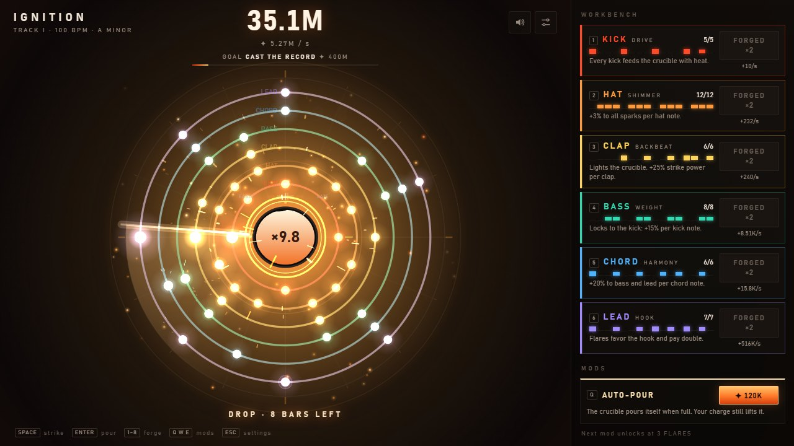
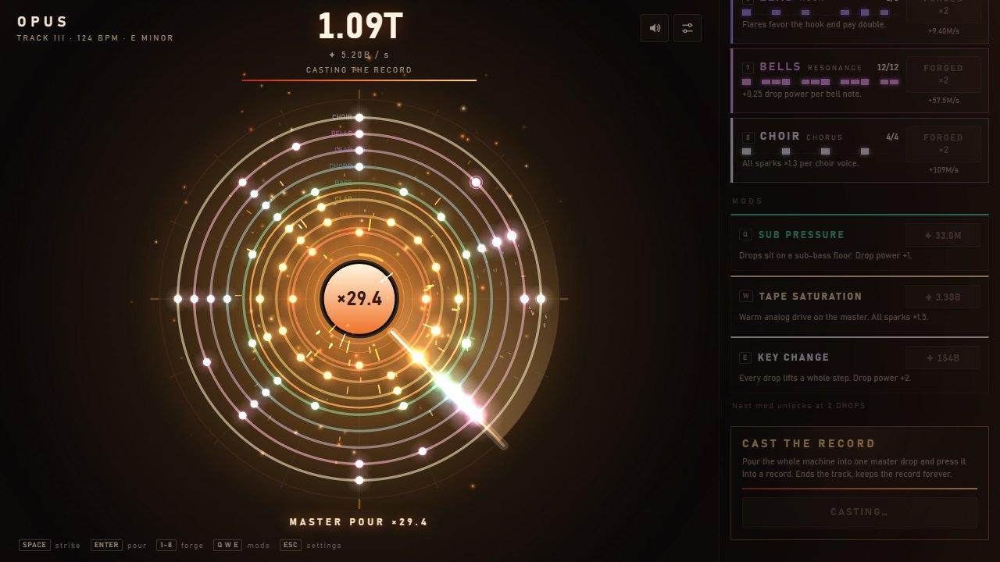
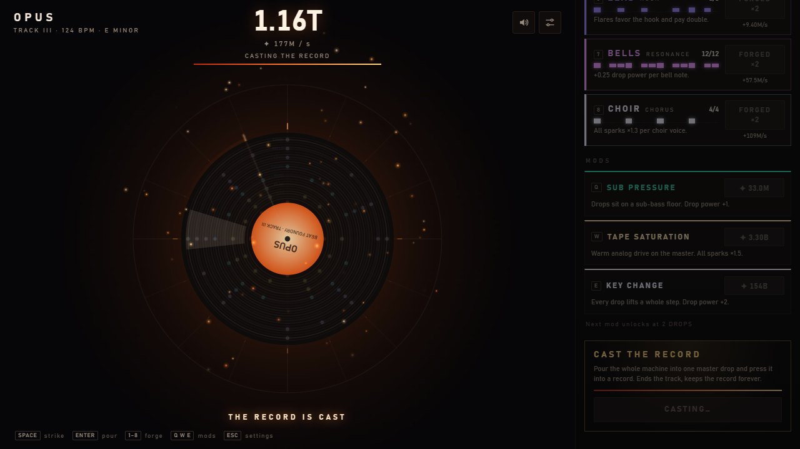
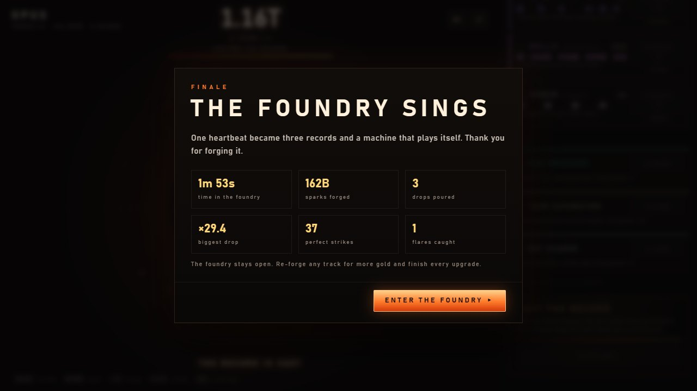
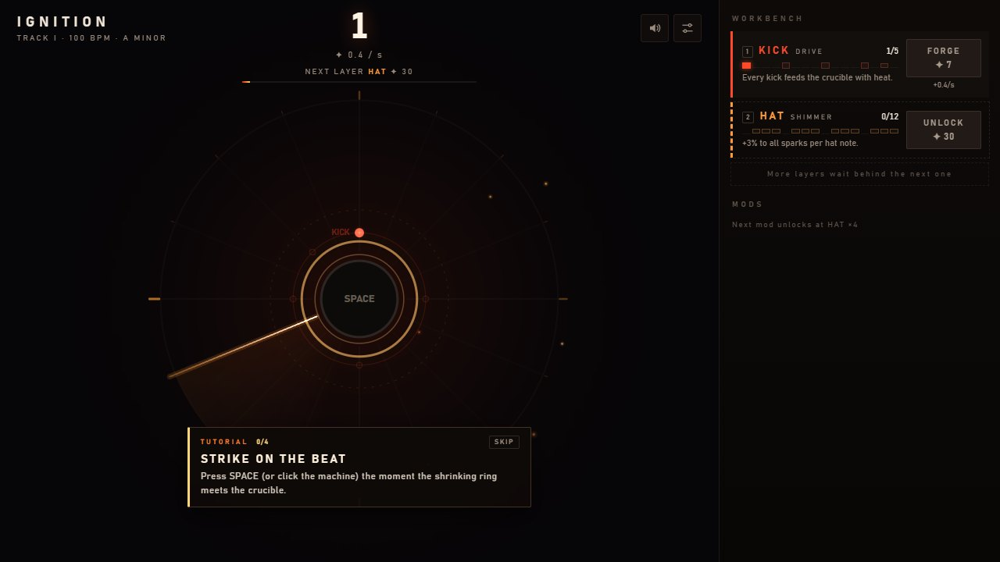

# BEAT FOUNDRY

[Play in your browser](https://legerdo.github.io/beat-foundry/) · [GitHub repository](https://github.com/Legerdo/beat-foundry)

Version **1.2.0** · 한국어 / English. The game follows your browser language; switch languages on the title screen or in settings.

A rhythm incremental game. You start with one kick drum on a spinning sequencer ring and forge it, note by note, into a full track that plays and earns by itself. Heat builds, you pour it into a drop, and at the end you cast the whole machine into a record.



## Screenshots

| | |
|---|---|
|  |  |
| **First beats.** One ring, a few kicks, the first unlock. | **Groove.** Five layers playing; every lit socket earns as it sounds. |
|  |  |
| **Build.** Strike the markers on the rim to charge the drop. | **Drop.** The crucible pours and multiplies everything for 8 bars. |
|  |  |
| **Forged machine.** A fully built Track I in its drop. | **Master pour.** The OPUS finale, eight rings at once. |
|  |  |
| **Cast.** The machine is pressed into a record. | **Finale.** Three records cast. |



**First-session coach.** Eight action-based lessons introduce striking, forging, lighting the crucible, pouring, charging, flares, mods and casting. Skip the coach at any time, or replay it from settings. The shrinking approach ring shows when to strike, and flares display a cue in their hit window. A small popup beneath the central multiplier shows PERFECT / GOOD / MISS and the sparks earned by that input for 1.4 seconds of active play. Its fade/pop freezes while paused, and clicks pass through to the machine. Early/late advice panels and the timing meter remain removed. Accuracy still affects rewards, charge and perfect-hit statistics. Note and mod prices use a 50% discount from their original base prices, with an additional OPUS track discount. Permanent gold upgrades also cost less; the first OPUS choir note now costs 10.8B sparks. Casting targets are 120M / 2.40B / 400B, with OPUS reduced from 2.00T. The pacing tests check purchase gaps and the final savings wait as well as completion time.

## Run

On Windows, double-click **`BeatFoundry.bat`**. Building and serving needs [Node.js](https://nodejs.org) 20.19+ on the 20.x line, or 22.12+. Use Node.js 24 for development and tests; the installed Vitest version has a stricter Node requirement. On the first run the launcher installs dependencies and builds the game, then serves it and opens your browser at `http://localhost:4390` (or the next free port). Keep the window open while you play. Run `BeatFoundry.bat rebuild` after changing the code.

Manually:

```bash
npm install
npm run dev        # http://localhost:5173
npm run build      # production build in dist/
npm run preview    # serve the build
npm test           # unit tests + pacing simulation
npm run sim        # detailed pacing results
```

For browser checks, start `npm run dev -- --port 5391 --strictPort`, then run:

```bash
node scripts/playtest.mjs http://localhost:5391/?dev all
node scripts/playtest.mjs http://localhost:5391/?dev tutorial
node scripts/playtest.mjs http://localhost:5391/?dev mobile
node scripts/playtest.mjs http://localhost:5391/?dev pause
node scripts/playtest.mjs http://localhost:5391/?dev focus
node scripts/playtest.mjs http://localhost:5391/?dev timing
node scripts/playtest.mjs http://localhost:5391/ debug
node scripts/playtest.mjs http://localhost:5391/?dev economy
node scripts/perf.mjs http://localhost:5391/?dev 4
```

The scripts use installed Microsoft Edge by default (`PW_CHANNEL=chrome` selects Chrome). The tutorial scenario defaults to Korean; set `LANG_UI=en` for English. `all` covers early play, builds, drops, casting, the finale and save/reload; tutorial, mobile, pause, focus, timing and performance checks are separate scenarios. `pause` checks frozen state/canvas, audio resume, rapid toggles, visibility overlap and a paused build. `timing` checks Korean/English central feedback and actual beat/flare rewards, desktop/mobile/drop placement, pause/expiry, reduced motion, click-through, clearing on track changes and choir purchases at the reduced price. Automation uses an isolated browser profile and `?dev` hooks to accelerate later scenes. Screenshots go to `playtest-shots/`; the performance script measures main-thread frame work and total frame intervals under 4× CPU throttling.

Everything is synthesized with the Web Audio API. There are no audio or image assets and no runtime dependencies.

## How it plays

- The machine is a set of rings, one per instrument. Each lit socket is a note. The beam sweeps a bar, and every note it crosses plays and earns sparks. What you hear is exactly what you earn.
- **Strike** (Space / F / J / D / K / click or tap on the machine) on the beat. Early on, striking is how you grow. Later it adds groove and heat on top of what the machine already plays.
- **Forge** notes on the workbench (or press 1–8). Each layer has its own job: kicks heat the crucible, hats lift everything, claps light the crucible, bass locks to the kick, chords feed bass and lead, the lead draws flares, bells deepen drops, the choir multiplies it all. Fill a whole ring and it is *forged*: the full pattern plays and pays double.
- **Mods** change how the music sounds and how it earns: open hats, echo, sidechain pump, a reverb cathedral, supersaw drops, swing, key changes. Q / W / E buy the first three visible mod slots.
- **Pour** (Enter) when the crucible is full. The track filters up into a build. Strike the markers on the rim to charge it, then comes a one-beat silence and the drop multiplies everything for 8 bars.
- **Flares**: a golden note sometimes appears. Strike as the beam hits it for a big burst of sparks and heat.
- **Cast the record** once every layer is live. Click the cast button or press C twice within 3 seconds to confirm. You get a longer master build, a master pour, and a record that multiplies all sparks forever, plus gold for permanent foundry upgrades (Warm Start, Apprentice auto-forge, Deep Crucible and more).
- Three tracks: **IGNITION** (100 BPM house, A minor), **TEMPER** (112 BPM breaks, D minor, adds bells), **OPUS** (124 BPM anthem, E minor, adds choir). The finale of OPUS quotes the earlier melodies and lifts a whole step before the last chord. After the finale you can re-forge any track.

The current pacing simulations total about 16 minutes for the active profile and 28 minutes for the casual profile across three tracks. These use fixed upgrades and input rates; actual completion time varies by play style. Progress saves automatically to localStorage, and the foundry keeps earning (up to 4 hours) while you are away. Browser saves are separate for the local game and the public Pages site.

The workbench holds its layout while the pointer moves over it, newly shown buttons ignore clicks for 350 ms, and purchased mods stay in their slots. Pointer clicks release button focus so Enter can pour without buying the same item again; Tab navigation keeps keyboard focus.

Layer unlocks, forged rings and mod upgrades show their name and explanation for six seconds, with short entry/exit fades. A new upgrade replaces the previous message and restarts its timer. Pausing also pauses the reading timer. `node scripts/playtest.mjs http://localhost:5391/?dev banner` checks visibility, reduced motion and pause behavior.

## Settings

Esc opens settings and pauses music, production, strike input and game animations. Closing settings continues from the same audio sequence. Losing browser focus also pauses the game; returning focus resumes it only if settings are closed and the page is visible. Clicking another in-game control keeps the game running. Existing offline income for time spent in a hidden tab or with the game closed is retained; visible focus loss earns no offline income. The `focus` playtest covers window focus events, real tab activation, overlapping settings and paused builds.

Settings include language, master/music/effects volume, screen shake, flash intensity, reduced motion (it follows the OS preference by default), timing guide, tutorial hints/replay, graphics quality (auto/high/low), and an input offset for audio latency. M toggles mute. Auto quality adjusts canvas resolution when frame times rise.

**Debug / Cheats** is available inside settings. It can grant 1M or 1B sparks, fill the current casting budget or heat, forge every current layer, unlock current-track mods, and grant 10 gold. The menu stays paused and writes changes to your save. Cheats are available after starting a track and disabled while casting. The `debug` playtest uses the normal production page without `?dev` to verify menu actions, persistence, pause, mobile layout, casting and discounted gold purchases.

The `economy` playtest checks all three displayed casting targets, rejects attempts below budget, verifies the actual deduction through the normal casting control, and completes the OPUS finale. Pacing simulations use fixed upgrade/input profiles; their timings are regression targets, not a promise for every play style.

## Code map

- `src/audio/engine.ts`: synth voices, buses, reverb/echo, build/impact FX
- `src/audio/music.ts`: the arranger. Turns the current machine and section into notes for each 16th step (pure, tested)
- `src/audio/transport.ts`: lookahead scheduler on the AudioContext clock. Timing never depends on frame rate.
- `src/game/economy.ts`: prices, multipliers, drop power, gold. Bar income is computed by running the arranger itself.
- `src/game/game.ts`: sections (groove → build → drop → break, cast → finale → outro), strike judging, flares, purchases, prestige
- `src/render/renderer.ts`: canvas machine, crucible, particles, camera
- `src/ui/hud.ts`: workbench, goals, banners, modals
- `src/i18n.ts`: Korean/English UI, instrument/mod/upgrade descriptions and tutorial text
- `scripts/playtest.mjs`: headless Edge playtest (screenshots, audio levels, frame times). Needs `npm run dev` running, and the game opened with `?dev` for test hooks.
- `scripts/screenshots.mjs`: regenerates `docs/screenshots/`. Run it against a running server, e.g. `node scripts/screenshots.mjs http://localhost:5173/?dev`.
- `scripts/perf.mjs`: OPUS drop performance at 1600×900, device scale factor 2, with configurable CPU throttling.
- `docs/PROMPT.md`, `docs/HANDOFF.md`, `CHANGELOG.md`: original request, handoff status and version history.

## Deploy

GitHub Actions tests and builds the game with Node.js 24, then deploys `dist/` to GitHub Pages after a push to `main`. You can also run **Deploy GitHub Pages** manually from the repository's Actions tab. Vite uses relative asset paths for the `/beat-foundry/` project URL.
